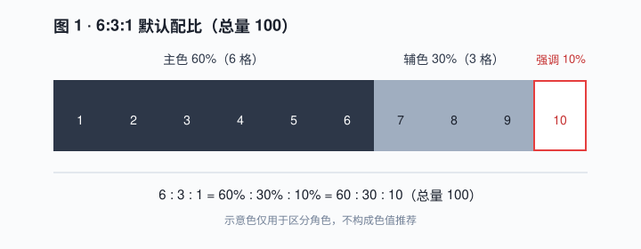
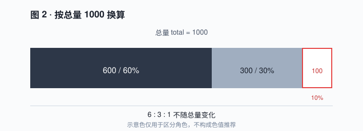
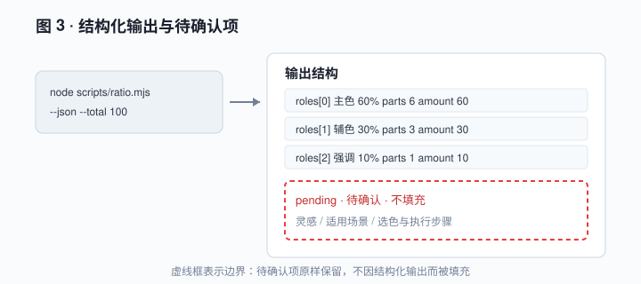

# 典型实例说明

三个实例分别对应 `color-631` 的三项可调用能力。每个实例按「场景描述 — 配图或示意图 — 文字解读 — 预期效果」组织，配图与本实例一一对应，不跨实例引用。

> 通用说明：所有配图中的灰阶与描边仅用于区分主色／辅色／强调三个角色，**不构成色值推荐**；三类颜色如何选定属于「待确认」。

---

## 实例 1 · 查询默认配比

### 场景描述

设计任务开始前，只需确认三类颜色角色各占多少，不指定总量。直接运行默认命令：

```bash
node scripts/ratio.mjs
```

### 配图或示意图



图 1 — 总量 100 下的 10 等份配比：主色 6 格、辅色 3 格、强调 1 格。

### 文字解读

输出三行，每行依次是「角色 / 百分比 / 份数」：主色 60% → 60、辅色 30% → 30、强调 10% → 10，合计 100。

`6:3:1` 与 `60% / 30% / 10%` 是同一配比的两种写法：前者是份数比，后者是百分比。图中 10 个格子按 6、3、1 分组，正是这一对应关系的直观表示。

末行的「待确认」提示是输出的固定部分，说明灵感来源、适用场景、选色与执行步骤尚未确认。

### 预期效果

- 得到三类角色及其占比与份数。
- 不得到任何具体颜色、色值或落位建议。
- 「待确认」提示必须保留，不得据此补写规则。

---

## 实例 2 · 按总量换算

### 场景描述

需要把配比映射到具体总量，例如把 1000 份按 6:3:1 分配：

```bash
node scripts/ratio.mjs --total 1000
```

### 配图或示意图



图 2 — 总量 1000 下的三段分配：600 / 300 / 100。

### 文字解读

输出变为 600 / 300 / 100，合计 1000；百分比仍是 60% / 30% / 10%。

`--total` 接受任意正数（例如 `--total 10` 得到 6 / 3 / 1），比例固定，不随总量变化。图中三段宽度按 60% / 30% / 10% 绘制，标注的是换算后的份数。

换算只做数值分配，不判断这些份数应落在画面的哪个位置。

### 预期效果

- 得到可直接用于分配份数的三个数值。
- 总量改变只改变份数，不改变 `6:3:1`。
- 不产生选色、色值或落位建议。

---

## 实例 3 · 结构化输出与待确认项

### 场景描述

下游流程需要机器可读结果，同时要确认「待确认」信息没有被填充：

```bash
node scripts/ratio.mjs --json --total 100
```

### 配图或示意图



图 3 — JSON 输出结构：roles 三行固定，pending 区块以虚线标出「待确认 · 不填充」。

### 文字解读

`roles` 数组固定三项，每项含 `name`、`percent`、`parts`、`amount`；`total` 记录本次换算基准，`ratio` 恒为 `6:3:1`。

`pending` 恒存在，包含 `inspiration`、`applicableScenarios` 与 `usage` 待确认列表，内容与 `rules.json` 一致。

虚线区块表示边界：这些项原样保留，脚本不会填充，也不会因为 JSON 格式而变成已确认规则。

### 预期效果

- 得到可直接解析的 JSON，字段名与 `SKILL.md` 的「输出结果」一致。
- 待确认项保持原样，不会被补齐。
- 若下游需要选色或色值，本 Skill 明确不提供，应停止并说明超出范围。
